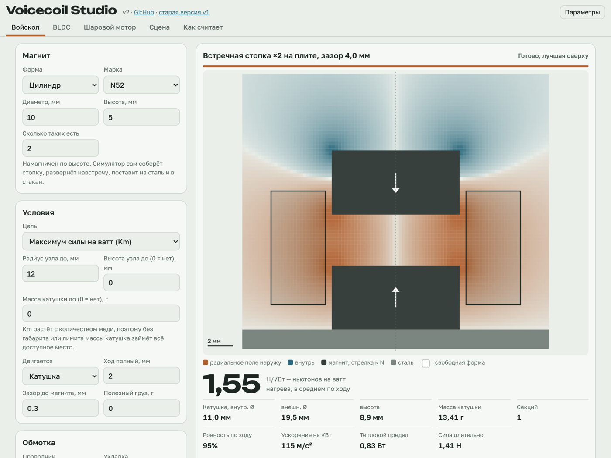
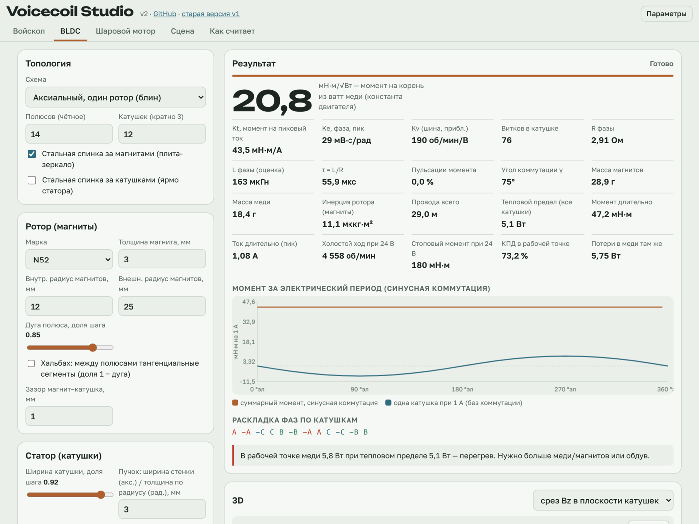
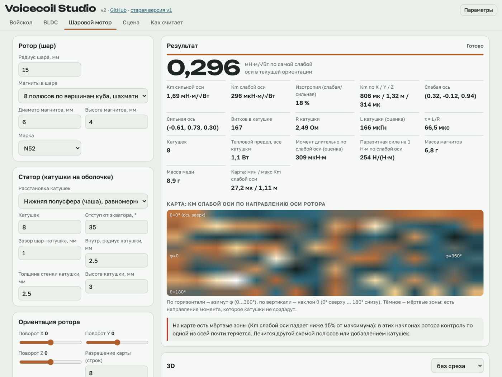
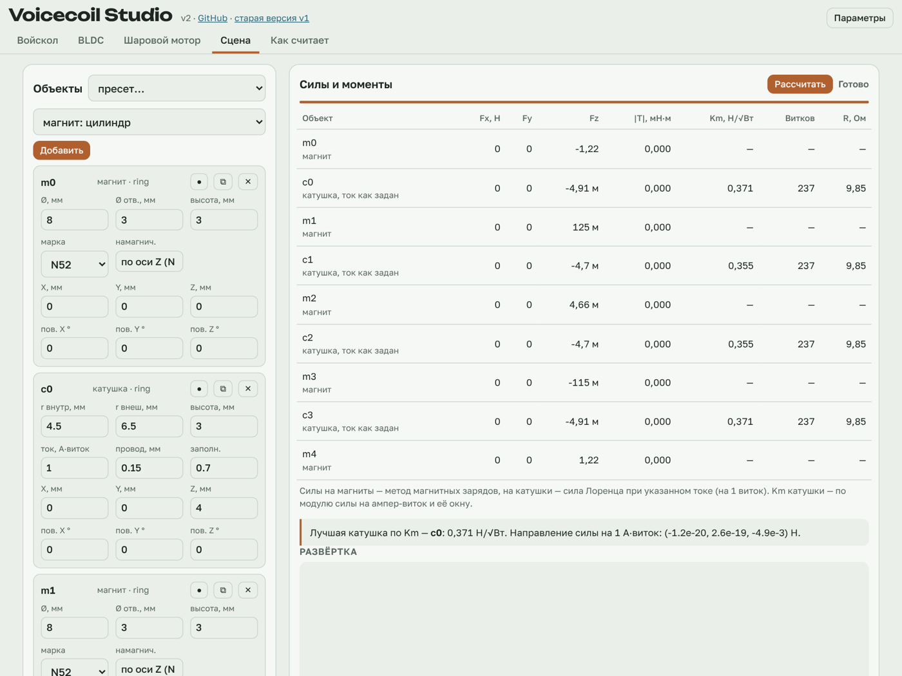

# Voicecoil Studio

Среда для расчёта магнитных актуаторов прямо в браузере: войсколы под конкретный магнит, безжелезные BLDC, шаровые моторы и произвольные сцены из магнитов, катушек и стальных плит. Один физический движок, несколько прикладных вкладок, никакого бэкенда — всё считается в Web Worker на телефоне или ноутбуке.

*Browser-based design environment for voice coils, ironless BLDC motors, spherical motors and arbitrary magnet/coil assemblies. Exact analytic fields, Lorentz and magnetic-charge forces, image-plate steel, motor constant Km everywhere. Russian UI.*

**Живая версия:** https://okokcomputer.github.io/voicecoil-studio/ · **старая v1 для сравнения:** https://okokcomputer.github.io/voicecoil-studio/v1/



## Что внутри

| Вкладка | Что считает |
|---|---|
| **Войскол** | Под заданный магнит (цилиндр/кольцо, 1–6 шт) перебирает компоновки — стопка, встречная стопка с подбором зазора, плита-зеркало, стакан с ярмом — и для каждой находит сечение катушки с максимальным Km (Н/√Вт) или ускорением на √Вт. Раскладка витков под ваш провод и напряжение, тепловой предел, «свободная форма» и «градиентная обмотка» как потолки. |
| **BLDC** | Аксиальный (один или два ротора, стальные спинки, Хальбах) и радиальный безжелезный. Kt, Ke, Kv, R и L фазы, τ = L/R, Km = Kt/√(1,5·R), пульсации, инерция ротора, тепловой предел, КПД в рабочей точке, звезда пазов для любой пары полюсов/катушек, оптимизатор по Km. |
| **Шаровой мотор** | Магниты в шаре (куб, октаэдр, тетраэдр, икосаэдр, диполь) и катушки на оболочке. Матрица моментов 3×N, Km по направлениям через сингулярные числа, карта мёртвых зон по ориентациям ротора, паразитные силы. |
| **Сцена** | Любые магниты (цилиндр, кольцо, блок, сегмент дуги, диаметральный цилиндр, шар), катушки (круглая, рейстрек, сектор, спираль, седло), стальные плиты. Силы и моменты на всё, Km каждой катушки, развёртка любого параметра, срезы поля. Пресеты: встречные магниты, HDD-VCM, цепочка магнит–катушка, матрица спиралей. |





## Как считает

- **Поле магнитов.** Цилиндры и кольца с осевой намагниченностью — точно, по Дерби–Олберту (эллиптические интегралы Булирша). Блоки, сегменты дуги, диаметральные цилиндры — как равномерно намагниченные многогранники: каждая грань несёт заряд σ = M·n, поле заряженного многоугольника берётся в замкнутом виде (телесный угол + логарифмы по рёбрам). Кривые поверхности фасетируются. Шар — точный диполь.
- **Силы.** На катушку — сила Лоренца по нитям пучка (Гаусс по отрезкам). На магнит — ∮σ·B по заряженным граням. Методы сверены между собой: третий закон Ньютона сходится лучше 1%.
- **Сталь.** Бесконечная плита μ→∞ — методом изображений (точно без насыщения), две плиты — цепочка отражений. Стакан с ярмом в войсколе — магнитная цепь, оценка ±30%.
- **Km** — константа двигателя: сила или момент на корень из ватт меди. От числа витков и провода не зависит; витки считаются в конце, под напряжение драйвера.
- **BLDC** — момент одной катушки за электрический период, остальные катушки по симметрии, Фурье-интерполяция, синусная коммутация с оптимальным углом. Индуктивность — Максвелл для колец, Нейман с GMD пучка для остальных (±10%).

Подробнее — вкладка «Как считает» в приложении и [`CHANGELOG.md`](CHANGELOG.md).

## Что проверено

| Проверка | Результат |
|---|---|
| Поле заряженного многоугольника против прямого численного интегрирования | < 1·10⁻⁴ |
| Дерби–Олберт против фасетированной призмы (96 граней) | 0,3 % |
| Сила магнит–магнит: метод зарядов против поверхностных токов | 0,5 %, F₁ = −F₂ |
| Сила на катушку против силы на магнит, в т. ч. наклонные, с моментами | < 1 % |
| Плита-зеркало: тангенциальное B на плите | ~10⁻¹⁶ (одна), 4·10⁻⁵ (две, глубина 6) |
| Индуктивность против Уилера | ±1 % |
| BLDC: прямой расчёт всех катушек против синтеза по симметрии | < 10⁻⁴ |
| Kt против −dΨ/dθ (энергетическая согласованность) | 1 % |

Запустить: `npm test` (нужен Node ≥ 18, зависимостей нет).

## Запуск локально

ES-модули не работают с `file://`, нужен любой статический сервер:

```bash
npm run serve        # python3 -m http.server 8765 --directory src
# открыть http://localhost:8765/
```

## Структура

```
src/
  index.html              оболочка: вкладки, формы, 3D
  css/app.css
  js/engine/              физика (СИ, чистые функции, без DOM)
    vec.js                векторы, кватернионы, узлы Гаусса
    cylinder.js           Дерби–Олберт, поле витка, cel()
    polyhedron.js         заряженные грани многогранников, билдеры, зеркала, квадратура зарядов
    coils.js              катушки по нитям, Био–Савар, Лоренц, поток, намотка, индуктивность
    scene.js              сцена: компиляция, изображения в плитах, fieldAt, силы, срезы
  js/modules/             прикладные расчёты: voicecoil.js, bldc.js, spherical.js, freescene.js
  js/worker.js            модульный воркер
  js/ui/                  интерфейс: common.js, view3d.js (Three.js), панели вкладок, app.js
  js/vendor/              three.module.min.js, OrbitControls.js (без CDN)
  v1/index.html           первая версия, «Войскол под магнит» (октябрь 2026)
test/                     проверки в Node
docs/screenshots/
.github/workflows/        tests.yml — тесты; pages.yml — деплой src/ на GitHub Pages
```

## Соглашения

- Внутри движка — СИ (м, Тл, А, Н, Н·м); в интерфейсе — мм, градусы, граммы.
- Магнит: `{kind:'magnet', shape:'cyl'|'ring'|'block'|'arc'|'dcyl'|'sphere', dims, Br, mdir, mag, frame:{q,p}}`, кватернион `q = [w,x,y,z]`, намагниченность в локальной системе (цилиндр и кольцо — всегда вдоль +z).
- Катушка: `{kind:'coil', coil, I, frame}` — `I` на виток, витки добавляются при намотке.
- Плита: `{kind:'plate', frame}` — плоскость z = 0 локальной системы, нормаль +z смотрит к магнитам.
- Km катушки: `Km = f₁ · √(k_f·A_окна / (ρ·l_витка))`, где f₁ — сила на ампер-виток.
- 3-фазный BLDC: `Kt` — момент на пиковый ток фазы при синусной коммутации, `Km = Kt/√(1,5·R_ф)`, `Ke = Kt/1,5`.

## Не учитывается (пока)

Замкнутые ярма и насыщение стали, размагничивание магнита полем катушки, вихревые токи и потери в стали, температура магнитов (Br при 20 °C), масса каркасов, взаимная индуктивность фаз.

## Дорожная карта

1. Осесимметричный магнитостатический FEM в воркере — стакан, полюс, насыщение.
2. Радиальные BLDC со стальным ярмом.
3. Проверка рабочей точки магнита по Hcj и температуре.
4. Динамика: отклик по току и силе с учётом L/R, оценка вихревых токов, энергия за цикл.
5. Экспорт STL каркаса катушки и держателя магнитов под печать.

## Лицензия

MIT.
